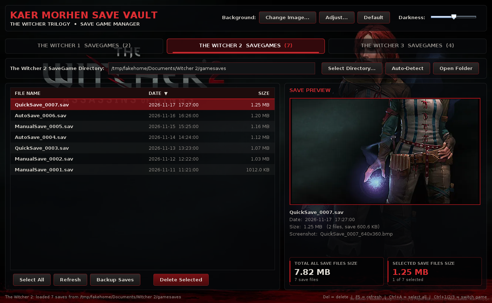
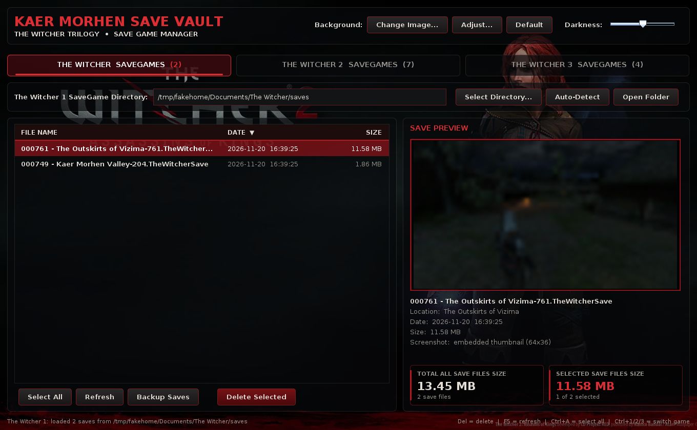
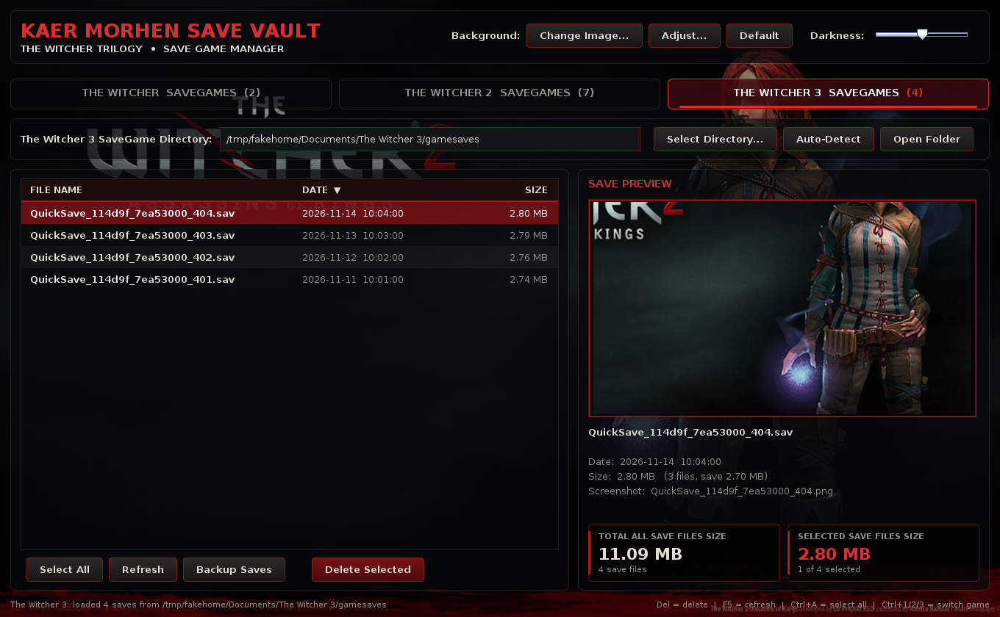
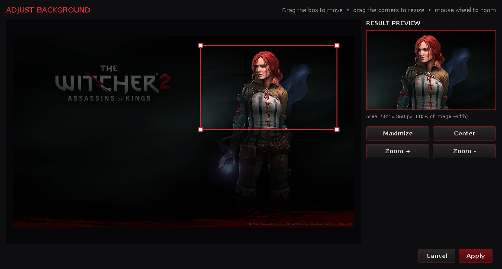

<div align="center">

# 🐺 Kaer Morhen Save Vault

### The Witcher Trilogy — Save Game Manager

Browse, preview, back up and clean up your save games for
**The Witcher**, **The Witcher 2: Assassins of Kings** and **The Witcher 3: Wild Hunt**, all in one themed desktop app.


<br>



</div>

---

## 📑 Table of Contents

- [Features](#-features)
- [Screenshots](#-screenshots)
- [Supported Games](#-supported-games)
- [Getting Started](#-getting-started)
- [Usage](#-usage)
- [Keyboard Shortcuts](#-keyboard-shortcuts)
- [How It Works](#-how-it-works)
- [Project Structure](#-project-structure)
- [Configuration](#-configuration)
- [Disclaimer](#-disclaimer)

---

## ✨ Features

| | Feature | Description |
|---|---|---|
| 🗂️ | **One tab per game** | Separate pages for The Witcher 1, 2 and 3, each with its own folder, list and settings |
| 🔍 | **Auto-Detect** | Finds the default save folders, including **Steam Cloud** for The Witcher 2 |
| 📋 | **Save list** | File Name / Date / Size, sortable by any column, with multi-selection |
| 🖼️ | **Save preview** | Medium-size screenshot of the selected save (embedded thumbnail for Witcher 1) |
| 📊 | **Size statistics** | Total size of all save files and size of the current selection |
| 💾 | **Backup Saves** | Selected or all saves packed into a timestamped `.zip` |
| 🗑️ | **Delete Selected** | Saves and their screenshots/metadata are moved to the **Recycle Bin** |
| 🎨 | **Custom backgrounds** | A different background image per game, with a darkness slider |
| ✂️ | **Background editor** | Choose exactly which part of the image is shown: move, resize, zoom, live preview |
| 📦 | **Portable** | A single `.jar`, settings stored next to it, no installer and no external libraries |

---

## 📸 Screenshots

<table>
  <tr>
    <td align="center"><b>The Witcher 1</b><br>embedded thumbnail and location read from the save</td>
    <td align="center"><b>The Witcher 3</b><br><code>.sav</code> + <code>.png</code> + <code>.json</code> grouped as one save</td>
  </tr>
  <tr>
    <td></td>
    <td></td>
  </tr>
</table>

<div align="center">

**Background editor**: pick the visible area of your wallpaper



</div>

---

## 🎮 Supported Games

| Game | Save files | Default location |
|---|---|---|
| **The Witcher** (Enhanced Edition) | `*.TheWitcherSave` (thumbnail and location embedded) | `Documents\The Witcher\saves` |
| **The Witcher 2** | `*.sav` + `*_640x360.bmp` | `Steam\userdata\<SteamID>\20920\remote` (Steam Cloud)<br>or `Documents\Witcher 2\gamesaves` |
| **The Witcher 3** | `*.sav` + `*.png` (+ `*.json` on newer versions) | `Documents\The Witcher 3\gamesaves` |

> [!NOTE]
> For The Witcher 2 the Steam install folder is read from the Windows registry
> (`HKCU\Software\Valve\Steam`), with `C:\Program Files (x86)\Steam` as a fallback.
> All Steam accounts under `userdata` are checked and the most recently used one is selected.

---

## 🚀 Getting Started

### Requirements

- **Windows** 10 / 11
- **JDK 21** (or a JRE 21 to only run the jar)

### Download & run

1. Download or clone this repository:
   ```bash
   git clone https://github.com/<your-user>/KaerMorhenSaveVault.git
   ```
2. Double-click **`run.bat`**. It builds the jar first if needed.

### Build from source

`build.bat` compiles with the JDK at:

```
C:\Program Files\Java\jdk-21.0.12.1\bin
```

Edit the `JDK` line in `build.bat` / `run.bat` if your JDK is installed somewhere else.

```bat
build.bat     :: compiles src\ and creates KaerMorhenSaveVault.jar
run.bat       :: starts the application
```

Manual build:

```bat
javac -encoding UTF-8 -d build src\kaermorhen\*.java
xcopy /e /i /y src\kaermorhen\res build\kaermorhen\res
jar cfe KaerMorhenSaveVault.jar kaermorhen.Main -C build .
java -jar KaerMorhenSaveVault.jar
```

---

## 🧭 Usage

1. **Pick a game tab**: *The Witcher 1 / 2 / 3 SaveGames*. The number next to each tab is its save count.
2. **Set the save folder**: it is detected automatically. You can also use **Select Directory...**, **Auto-Detect** or type a path and press <kbd>Enter</kbd>.
3. **Select saves** in the list to see the preview, date and size, and the *Selected Save Files Size*.
4. **Manage**:
   - **Select All**: selects every save in the tab
   - **Refresh**: re-reads the folder
   - **Backup Saves**: asks *Selected* or *All*, then writes `WitcherN_Saves_Backup_<date>.zip`
   - **Delete Selected**: asks for confirmation, then moves the files to the Recycle Bin
5. **Customize the background** for the current tab:
   - **Change Image...**: choose an image, then the editor opens to choose the visible area
   - **Adjust...**: re-open the editor for the current image
   - **Default**: restore the built-in wallpaper
   - **Darkness**: how much the background is dimmed

### Background editor

| Action | How |
|---|---|
| Move the area | Drag inside the red box, or click anywhere on the image |
| Resize | Drag one of the four corners (aspect ratio follows the window) |
| Zoom | Mouse wheel, or **Zoom +** / **Zoom -** |
| Largest area | **Maximize** |
| Center | **Center** |
| Confirm / discard | **Apply** / **Cancel** (<kbd>Esc</kbd>) |

---

## ⌨️ Keyboard Shortcuts

| Shortcut | Action |
|---|---|
| <kbd>Ctrl</kbd> + <kbd>1</kbd> / <kbd>2</kbd> / <kbd>3</kbd> | Switch to The Witcher 1 / 2 / 3 |
| <kbd>F5</kbd> | Refresh the current tab |
| <kbd>Ctrl</kbd> + <kbd>A</kbd> | Select all saves |
| <kbd>Del</kbd> | Delete selected saves |
| Double-click | Open the save folder in Explorer |

---

## ⚙️ How It Works

<details>
<summary><b>The Witcher 1: reading the embedded thumbnail</b></summary>

<br>

A `.TheWitcherSave` file is an archive with the signature `RGMH`.
The **last 8 bytes** hold the position and size of its file index:

```
[u32 indexOffset][u32 entryCount]
```

Each index entry is:

```
[u32 nameLength][name][u32 dataLength][u32 dataOffset]
```

The app looks for two entries:

- `<save>\<number>.tga`: an uncompressed 24-bit TGA thumbnail (64×64 canvas with a 64×36 picture; the grey padding is trimmed automatically)
- `<save>\savenfo.txt`: the location name, e.g. *Kaer Morhen Valley*

Only these small parts are read, so even 20 MB saves preview instantly.

</details>

<details>
<summary><b>The Witcher 2 & 3: grouping sidecar files</b></summary>

<br>

Every save is grouped with the files that share its base name:

| Game | Save | Sidecars |
|---|---|---|
| Witcher 2 | `ManualSave_0012.sav` | `ManualSave_0012_640x360.bmp` |
| Witcher 3 | `QuickSave_0_0001.sav` | `QuickSave_0_0001.png`, `QuickSave_0_0001.json` |

The **Size** column, backups and deletion always include the whole group.

</details>

<details>
<summary><b>Background crop</b></summary>

<br>

The selected area is saved as fractions of the image (`x, y, width, height`), so it stays correct
whatever the image resolution is. At runtime that area is scaled to *cover* the window.

</details>

---

## 🗂️ Project Structure

```
KaerMorhenSaveVault/
├── build.bat                     # build script (JDK 21 path)
├── run.bat                       # launcher
├── README.md
├── docs/
│   └── screenshots/              # images used in this README
└── src/kaermorhen/
    ├── Main.java                 # main window, game tabs, background controls
    ├── GameTab.java              # directory bar, save list, preview, backup, delete
    ├── Game.java                 # game definitions + auto-detect (Steam Cloud for W2)
    ├── SaveEntry.java            # save scanning (save file + sidecars)
    ├── W1SaveReader.java         # Witcher 1 archive reader + TGA decoder
    ├── CropDialog.java           # background editor
    ├── Ui.java                   # theme, glass panels, buttons, scrollbars
    ├── Settings.java             # portable settings
    └── res/
        └── background.png        # default background
```

---

## 🔧 Configuration

Settings are saved automatically in **`KaerMorhenSaveVault.properties`**, next to the jar:

| Key | Meaning |
|---|---|
| `saveDir.w1` / `w2` / `w3` | Save folder of each game |
| `bg.<game>` | Custom background image path |
| `crop.<game>` | Visible area of the background (`x,y,w,h` fractions) |
| `dim.<game>` | Background darkness (0–90) |
| `backupDir` | Last backup destination |
| `lastTab` | Tab opened on startup |

Delete the file to reset everything.

---

## ⚠️ Disclaimer

- This is an unofficial fan-made tool and is not affiliated with or endorsed by **CD PROJEKT RED**.
- *The Witcher* and all related names and artwork are trademarks of **CD PROJEKT S.A.**
  The default background wallpaper belongs to its respective owners.
- The app never modifies save contents. Still, **use Backup Saves before deleting anything**.

<div align="center">

<br>

Made with ⚔️ for the Witcher community

</div>
